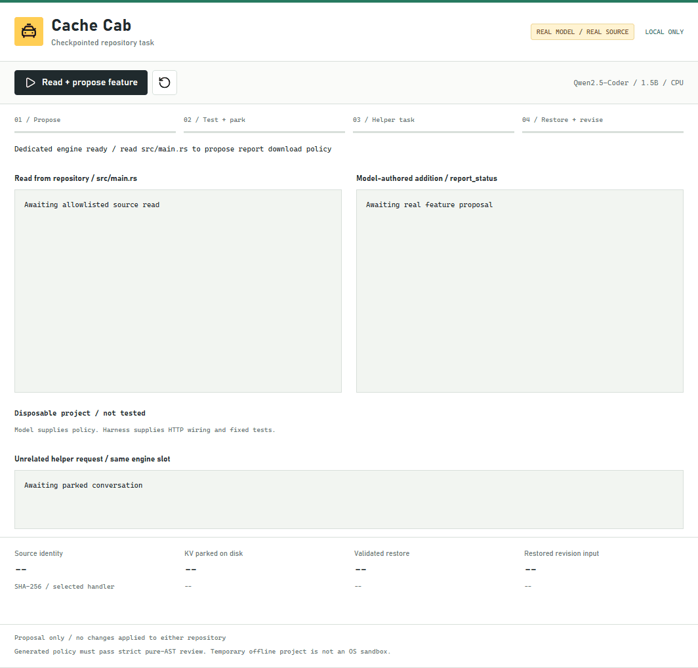
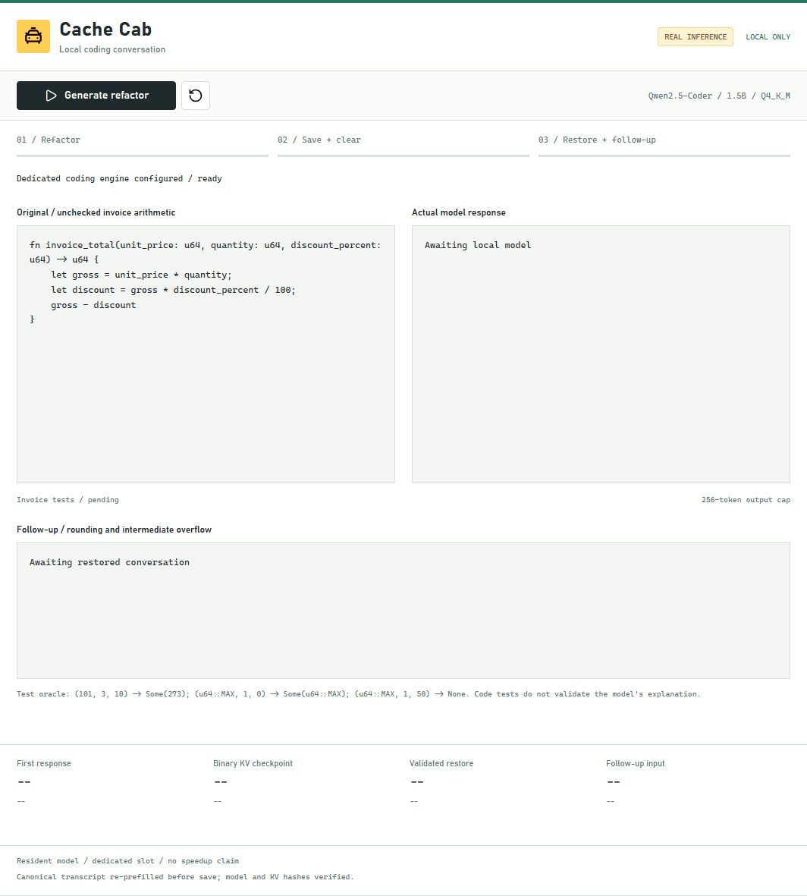
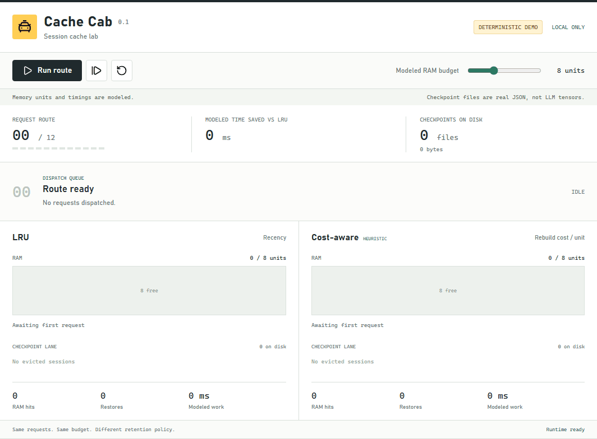

# LLM KV Cache Cab

[](https://github.com/Eismot/llm-kv-cache-cab/actions/workflows/ci.yml)
[](LICENSE)
[](Cargo.toml)

A Rust lab for parking a local coding conversation on disk, borrowing its engine
slot for another task, and restoring the conversation with real KV-prefix reuse.

The demo UI and internal Rust crate retain the shorter **Cache Cab** name.

## What You Can Try

| Experiment | What you see | What's real |
| --- | --- | --- |
| Cache policy | The same request route under LRU and cost-aware retention | JSON storage; memory units and timings are simulated |
| KV checkpoint | Save, clear, validate, restore, and continue a model prompt | Binary llama.cpp KV state, integrity checks, and engine counters |
| Coding conversation | A Rust invoice refactor, edge-case tests, and a restored follow-up | Local Qwen output and tests on accepted generated source |
| Repository task | Read source, propose feature logic, test, switch tasks, restore, and revise | Actual handler context, a temporary project, API checks, and prefix reuse |

The interesting moment: a repository conversation is parked, the same model slot
answers an unrelated helper request, then the original task resumes from a validated
checkpoint and consumes real compiler/test feedback. The UI exposes model output,
file identity, checkpoint bytes, test outcomes, and reused/new input tokens.

This is a small, inspectable systems experiment, not a general coding agent or a
new inference engine. The retention-policy comparison is not connected to real
engine scheduling. No speedup, RAM saving, or coding-quality advantage is claimed.



Five actual browser states; waits omitted, five seconds per state. This is not
real-time playback. See the [repository-task report](assets/repository-report.json).

## Status

The default comparison is a deterministic simulator: memory units and timings
are modeled, and its JSON checkpoints contain simulated history, not KV tensors.
An opt-in live lab now talks to a dedicated llama.cpp server and verifies actual
binary KV save/restore and prompt-prefix reuse. These modes remain separate.
A separate coding view now generates a real Rust refactor using Qwen2.5-Coder,
compiles its narrowly allowlisted actual source, saves and clears canonical
conversation KV state, then restores it for a genuine follow-up.
None of these experiments establishes a coding-quality benchmark or cache-policy speedup.

The repository-task view now reads an allowlisted handler from this checkout,
asks the model for report-download status logic, tests it in a disposable copy,
parks the conversation, runs a helper request in the same slot, then restores and
rechecks the model's revision. Model-authored policy and harness-authored HTTP
wiring/tests are labeled separately. No generated changes enter either working copy.

The same 12-request coding route runs through LRU and a cost-aware heuristic.
At the default eight-unit budget, helper requests displace the main conversation
under LRU, while cost-aware retention preserves it for a RAM hit. The heuristic
is greedy, not globally optimal, and is not guaranteed to win on every workload.

Read [JOURNEY.md](JOURNEY.md) for the development story and verified milestones,
and [VISION.md](VISION.md) for the hypothesis and open product decisions.

## Run

Requires Rust 1.81 or newer and Cargo. There is no frontend build step, CDN, model
download, cloud service, or account requirement.

```sh
cargo run --locked
```

Open `http://127.0.0.1:7331`. Use Run route for playback, the next-request icon
for single stepping, and reset to repeat. Changing the modeled budget resets both
policies to the same fresh trace. The final request exposes Replay route.

If the port is occupied:

```sh
cargo run --locked -- --port=7332
```

The server binds only to loopback and rejects unexpected hosts and browser
origins. Checkpoint routes live under .cache-cab; resets and normal shutdown remove
their simulator temporary directories. Live KV files are retained in the explicitly
configured slot directory. User repositories are never edited. The separate coding
experiment can invoke rustc and a temporary test binary only after its fixed AST
allowlist accepts the generated function.
The repository task can invoke offline Cargo tests after reviewing an even
narrower pure status-policy function.

Open this folder in VS Code to use the Cache Cab: Demo task.

## Real KV Checkpoint Lab

Use a dedicated, single-slot llama.cpp process. The test clears slot 0 before
and after execution; do not point it at an engine serving other clients.
The engine and Cache Cab must use the same absolute slot-save directory on this
machine. Model weights and engine binaries are not bundled or downloaded by the app.

Start the engine with your local GGUF and an absolute checkpoint directory:

```sh
llama-server --model /absolute/model.gguf --host 127.0.0.1 --port 7332 --parallel 1 --ctx-size 512 --device none --cache-ram 0 --slots --slot-save-path /absolute/slots/
```

Then either run the CLI probe or enable the browser panel:

```sh
cargo run --locked --bin engine_probe -- --endpoint=http://127.0.0.1:7332 --checkpoint-dir=/absolute/slots --output=report.json
cargo run --locked -- --engine=http://127.0.0.1:7332 --slot-dir=/absolute/slots
```

Use native Windows absolute paths on Windows. The optional Live KV Checkpoint
panel reports measured timings, engine token counters, and logical checkpoint
bytes. The default simulator remains available even without an engine.

Compatibility checks bind checkpoints to a SHA-256 of the GGUF file (including
its tokenizer metadata), the engine build string, effective slot context size,
and exact prompt token prefix. The binary checksum is validated before restoration.
This integrity check detects corruption; it is not authentication against an
attacker who can modify both the checkpoint and its manifest. Store files privately.

The verified local smoke test used llama.cpp build b11498 and a roughly 25 MiB
TinyStories 15M Q8 model. It restored a 284,244-byte KV checkpoint and reduced
prompt-token evaluation from 41 tokens to one, with 40 prefix tokens reused.
An exact-token-prefix continuation then reused 41 tokens and evaluated 11 new
tokens. It appends a separately tokenized fragment without another BOS token;
it does not assume independently concatenated text has identical tokenization.
This tiny model is not a coding model. Its checkpoint save/restore overhead can
exceed fresh prompt-processing time. A real coding workload must decide when
checkpointing is worthwhile; fewer evaluated tokens alone do not prove lower latency.

Prefill tests keep the model resident, generate no user-visible completion, and
do not measure model startup, OS-cold I/O, physical SSD reads, or coding quality.
Reported bytes are engine/file accounting, not a disk-bandwidth benchmark.

## Real Coding Conversation

This experiment requires the exact approved
[Qwen2.5-Coder-1.5B-Instruct Q4_K_M artifact](https://huggingface.co/Qwen/Qwen2.5-Coder-1.5B-Instruct-GGUF/tree/f86cb2c1fa58255f8052cc32aeede1b7482d4361).
Its size is 1,117,320,768 bytes; its SHA-256 is:

```text
cc324af070c2ecbfd324a30884d2f951a7ff756aba85cb811a6ec436933bb046
```

The app does not download models. Keep weights and checkpoints under the ignored
.cache-cab directory. With a dedicated CPU llama.cpp engine:

```sh
llama-server --model /absolute/qwen2.5-coder-1.5b-instruct-q4_k_m.gguf --host 127.0.0.1 --port 7332 --parallel 1 --ctx-size 2048 --threads 4 --threads-batch 4 --device none --cache-ram 0 --slots --slot-save-path /absolute/coding/slots/ --no-context-shift
cargo run --locked -- --engine=http://127.0.0.1:7332 --slot-dir=/absolute/coding/slots
```

Use native absolute paths on Windows. Open `http://127.0.0.1:7331/?view=coding`.
Generate refactor, Save + clear slot, and Restore + follow-up are separate steps.
Reset conversation clears the owned slot and starts a new run. The unrelated KV
probe cannot overwrite an active coding experiment; reset it first.

The original invoice function multiplies a unit price by quantity, computes a
percentage discount, and subtracts it without checking overflow or invalid rates.
The model is asked to return `Option<u64>`, reject percentages above 100, use checked
arithmetic, round the discount down, and propagate intermediate overflow as None.
syn parses the complete response and permits only a bounded pure-code subset:
simple bindings, comparisons, branches, Option propagation, and checked arithmetic.
Macros, attributes, imports, loops, extra items, and arbitrary calls are rejected.
The actual accepted source is compiled in a temporary directory and tested against
12 fixed cases: zero values, normal invoices, rounding, invalid percentages, full
discounts, gross overflow, and discount-intermediate overflow.
Unexpected output is displayed but not executed. This is not a general-purpose
sandbox or a general coding agent.

Before saving, the actual answer is rendered into a canonical conversation through
the engine's chat-template API and re-prefilled. The checkpoint contains the exact
token prefix shared with the rendered follow-up; any ambiguous boundary suffix
is excluded and counted. This avoids assuming emitted text and generation KV have
identical tokenization or stop-token state.

The captured b11498 run returned an invoice function that passed all 12 cases
and restored 7,459,604 bytes of binary KV state. Its follow-up reused 260 prefix
tokens and evaluated 78 new input tokens. Actual wall-clock timings are retained
in the measured report; these individual observations are not a benchmark.
Model hashing, canonical re-prefill, and generation are additional work, not free
checkpoint overhead. Resident-model results do not prove RAM savings or speedups.

The follow-up deliberately asks about rounding and large-value edge cases. The
small model gave two incorrect results despite generating correct tested code:
(101, 3, 10) returns Some(273), not 300; (u64::MAX, 1, 0) returns Some(u64::MAX),
not None. The original answer remains visible beside the fixed test oracle.
The browser checks verify delivery and restoration, not correctness of prose.

The coding view uses at most 256 generated tokens per answer and reserves output
space inside the effective slot context. Model hashing can make the first step
noticeably slower than the response timing alone. Inference HTTP connections are
not pooled across these waits to avoid stale engine keep-alive connections.

## Checkpointed Repository Task

Use the same dedicated Qwen engine and app configuration as the coding conversation,
then open `http://127.0.0.1:7331/?view=repository` and reset the active experiments.
The four actions are Read + propose feature, Review/test + park, Run helper request,
and Restore/revise + test.

The reader loads only src/main.rs, verifies its Rust syntax, extracts the existing
coding_state handler, and records the complete file's SHA-256. It does not send
the entire repository, secrets, Git history, or generated artifacts to the model.
The task is to implement report_status(configured, busy, has_report) for a new
GET /api/coding/report JSON attachment: 503 when unconfigured, 409 when busy,
404 without a report, and 200 otherwise.

Only this bounded function shape is executable. The AST reviewer permits boolean
parameters, branches, returns, and the four status literals; it rejects calls,
macros, loops, attributes, extra items, and arbitrary paths. The model is not a
general patch agent. The harness supplies deterministic HTTP wiring and tests,
with a unique route insertion anchor, only in a temporary copy of Cargo.toml,
Cargo.lock, src, and web. Generated logic is compiled exactly as returned.

Three fixed tests cover all eight status combinations, JSON attachment/body
preservation, and the actual route's unavailable response. Cargo runs with
--offline --locked, two build jobs, and a 180-second timeout. The ignored
.cache-cab/repository-target cache avoids rebuilding every dependency each run.
The temporary directory is deleted after checks. This is not an OS sandbox;
the strict generated-code boundary is what makes this narrow experiment acceptable.

The first proposal passed. The harness saved its canonical conversation prefix,
cleared the slot, generated a genuine unrelated HTTP helper answer, and cleared
again. Restoring that checkpoint let the model consume the actual compiler/test
feedback; it retained its already correct function, and all three tests passed
again. No repair was needed, and no generated feature was installed into the
running app or either source repository.

The recorded desktop run restored a 10,615,284-byte checkpoint, reused 370 prefix
tokens, and evaluated 844 new feedback-input tokens. Full prompts, source identity,
proposal, deterministic patch plan, compiler output, helper answer, revision, and
timings live in the measured report. Logical bytes and token reuse are not a
speedup or physical-disk benchmark. Compiler paths in public reports are normalized
to placeholders. Captured timings, token counts, checkpoint accounting, and model
answers are retained. Review new artifacts before publishing; redaction is not a
general secret-scanning service.

## Verify

```sh
cargo test --locked --all-targets
cargo fmt --all -- --check
cargo clippy --locked --all-targets -- -D warnings
```

Tests cover policy differences, budget invariants, rejected requests, corrupted
and incompatible checkpoints, transactional eviction on storage failure, the HTTP
API, host/origin checks, and GIF encoding. Unsafe code is forbidden in this project's
Rust crates. Dependencies may have their own unsafe implementations.

Optional developer tools:

```sh
uvx --from rumdl==0.2.78 rumdl check .
cargo audit --deny warnings
```

Cargo.lock retains Rust-1.81-compatible HTTP dependencies. Review the minimum
toolchain and advisory gates when updating dependencies.

## Demo Capture

The repository GIF above uses five actual UI states, five seconds each, with all
model/checking waits omitted. The first clean offline build can take minutes;
the GIF is an edited state sequence, not real-time playback.

With the configured app already listening and the dedicated model available:

```powershell
$env:CACHE_CAB_REPOSITORY_TEST = "1"
npm run test:browser -- --project=desktop --grep "opt-in repository feature"
cargo run --locked --bin capture_gif -- captures/repository assets/repository-demo.gif 500
```

The earlier invoice coding capture remains available:



The coding GIF is captured from the actual browser UI and model responses.
Its four states play for five seconds each; generation waits are omitted.
The complete measured report includes raw answers, engine identity, counters,
checkpoint metadata, and validation output. Recreate the capture against the
dedicated coding engine:

```powershell
$env:CACHE_CAB_CODING_TEST = "1"
npm run test:browser -- --project=desktop --grep "opt-in real coding"
cargo run --locked --bin capture_gif -- captures/coding assets/coding-demo.gif 500
```

The original policy comparison remains a separate simulation capture:



To capture a new version, reset the budget to eight, use a fixed desktop viewport,
and export identically sized PNG frames of the comparison region while stepping
through the route. Number files in playback order, for example frame-00.png.
The captures directory is ignored by Git. Then encode with the included Rust tool:

```sh
cargo run --locked --bin capture_gif -- captures assets/demo.gif 85
```

The final argument is the delay per frame in centiseconds. The encoder produces
a looping GIF. Keep the simulation disclosures visible in portfolio captures.

For reproducible browser tests and frame capture, install the optional development
tools with Node.js 20 or newer. These are not needed to run Cache Cab:

```sh
npm ci --ignore-scripts
npx playwright install chromium
npm run test:browser
npm run capture:frames
cargo run --locked --bin capture_gif -- captures assets/demo.gif 85
```

Browser tests cover desktop/mobile layouts, image loading, policy differences,
playback, pause/resume, reset, budgets, and the fixed-dimension portfolio capture.
Captured trace JSON lives beside the frames for inspection.

Live browser verification is opt-in. With the app connected to a dedicated engine,
set `CACHE_CAB_LIVE_TEST=1` before running `npm run test:browser`. It checks the
actual KV round trip on desktop and mobile and saves screenshots under assets.
Normal browser tests neither download models nor require an inference engine.
The coding conversation check is separately opt-in with `CACHE_CAB_CODING_TEST=1`.
It verifies actual model answers, allowlisted boundary tests, KV restoration,
nonzero reused/new input counters, fixed frame dimensions, and desktop/mobile layout.

## Architecture

- src/lib.rs: validated identities, budgeted policies, and atomic checksummed storage.
- src/demo.rs: identical request traces, modeled costs, and real checkpoint accounting.
- src/main.rs: localhost HTTP API, static assets, and input/origin boundaries.
- src/llama.rs: bounded loopback HTTP client for the actual engine protocol.
- src/live.rs: binary KV compatibility checks and measured round-trip reporting.
- src/coding.rs: staged coding conversation and syntax-aware pure-function validation.
- src/repo_task.rs: allowlisted source context, pure policy review, temporary repository tests, and checkpointed feedback.
- src/bin/engine_probe.rs: opt-in real-engine checkpoint smoke-test CLI.
- web: dependency-free browser controls and the comparison visualization.
- src/bin/capture_gif.rs: PNG-to-GIF encoder and its regression test.

The retention score is modeled recomputation cost divided by estimated session
size, with recency as a tie-breaker. A restore costs 180 modeled milliseconds;
a RAM hit costs 20. Those constants illustrate transitions and are not hardware
measurements. Filesystem bytes do not measure physical SSD reads or OS page-cache traffic.

## Next Experiment

Integrate the verified checkpoint adapter with session scheduling and benchmark
a representative coding-agent route beyond this single-function conversation,
including continuation and model-configuration changes.
Measure cold/warm startup, time to first token, generation speed, actual memory,
disk traffic, and task quality before claiming an improvement. Engine-level
SSD-backed expert scheduling is a later research project, not part of this MVP.

## Attribution

The browser icons are [Lucide](https://lucide.dev/); their license is retained in
[web/icons/LICENSE](web/icons/LICENSE). The application is MIT-licensed; see
[LICENSE](LICENSE).

See [THIRD_PARTY.md](THIRD_PARTY.md) for the reviewed dependency/model terms,
attribution boundaries, and redistribution caveats. Our MIT license does not
relicense icons, dependencies, engine binaries, or model weights.
